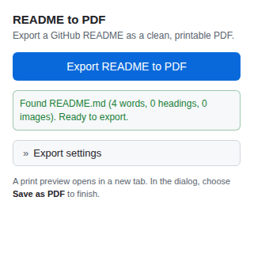
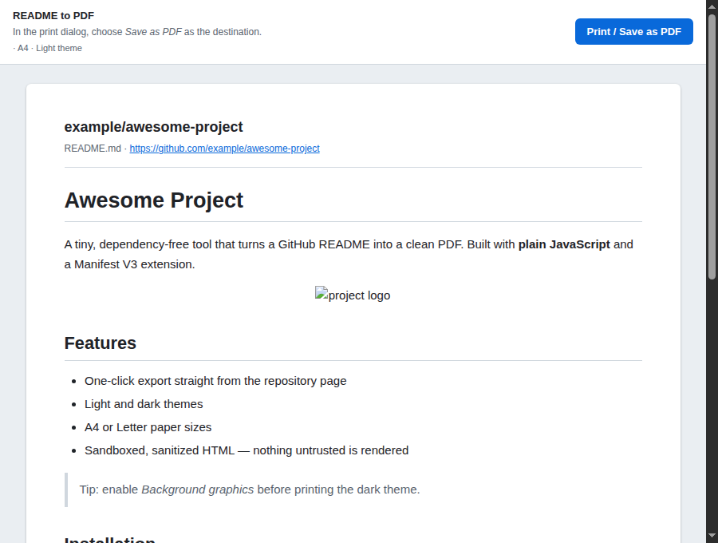
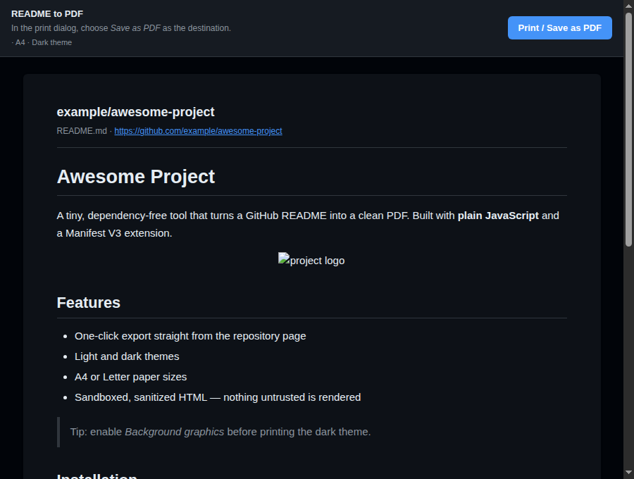
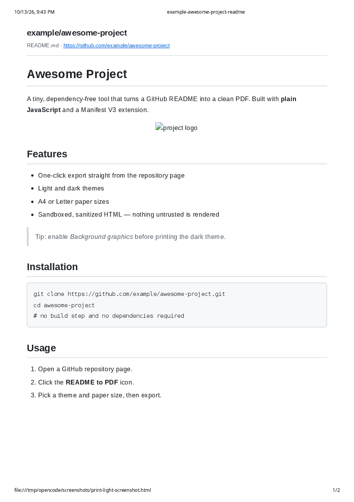

# README to PDF

A lightweight Chrome extension (Manifest V3) that exports a GitHub repository's
rendered README as a clean, printable PDF — using only the browser's own print
dialog, with no backend, no paid APIs, and no build step.

Built with plain HTML, CSS, and vanilla JavaScript.

## Features

- **One-click export** from any GitHub repository page to a print-ready document.
- **Native printing**: the extension prepares a dedicated print page and opens
  Chrome's print dialog, where **Save as PDF** produces the file. The PDF is
  created by the browser, not silently by the extension.
- **Reliable README detection** using GitHub's authoritative `<meta>` tags, an
  ordered list of DOM selectors, and a fallback to GitHub's embedded React JSON.
- **Only the README is exported** — no navigation, file listings, sidebars, or
  comments.
- **Export settings**:
  - Paper size: **A4** or **Letter**.
  - Theme: **Light** or **Dark** (with `prefers-color-scheme`-friendly colors;
    dark PDFs need "Background graphics" enabled in the print dialog).
  - Optional title header (repository name, path, and source link).
  - Settings persist via `chrome.storage.sync` and can be reset to defaults.
- **Safe by default**: README HTML is sanitized with a strict tag/attribute
  allowlist before it is rendered. Scripts, event handlers, and unsafe URLs
  never reach the document.
- **Accessible UI**: keyboard-accessible controls, visible focus states, and
  aria-live status reporting.
- **Sane filenames** such as `owner-repository-readme.pdf`.

## Screenshots

The popup (with settings), the print preview in light and dark themes, and a
sample exported PDF.









The full sample document is at [screenshots/sample.pdf](screenshots/sample.pdf)
(A4, exported through Chrome's native print pipeline).

## Installation (from source)

1. Open Chrome and navigate to `chrome://extensions`.
2. Enable **Developer mode** using the toggle in the top-right corner.
3. Click **Load unpacked**.
4. Select the project folder (the one containing `manifest.json`).
5. The extension appears in the list. Pin it to the toolbar for quick access.

After editing source files, click the **reload** icon on the extension card in
`chrome://extensions`.

This project has **no dependencies** — no `npm install`, no bundler, no build
step.

## How to use

1. Open a GitHub repository page, e.g. `https://github.com/user/repo` or
   `https://github.com/user/repo/tree/main`.
2. Click the **README to PDF** icon in the toolbar. The popup reports whether a
   README was found.
3. Optionally adjust **Export settings** (paper size, theme, title header).
4. Click **Export README to PDF**.
5. A print preview opens in a new tab and the print dialog appears. Set the
   destination to **Save as PDF** and save. The suggested filename is
   `owner-repository-readme.pdf`.

## Project structure

```
readme-to-pdf/
├── manifest.json          # Manifest V3 configuration
├── README.md              # This file
├── LICENSE                # MIT license
├── icons/                 # Extension icons (16/32/48/128 px PNG)
├── screenshots/           # Popup, preview, and sample PDF for the store
├── popup/
│   ├── popup.html         # Popup markup
│   ├── popup.css          # Popup styles
│   └── popup.js           # Detection, settings, and export flow
├── scripts/
│   └── content.js         # Repo detection + README extraction (content script)
├── print/
│   ├── print.html         # Print document (extension page)
│   └── print.js           # Sanitize, render, apply settings, call window.print()
└── styles/
    └── print.css          # Print document + print media styles
```

## Technical architecture

### Data flow

1. The popup asks the content script for the README via
   `chrome.tabs.sendMessage` / `chrome.runtime.onMessage`.
2. The content script detects the repository (meta tags, then URL), locates the
   rendered README (layered selectors, then embedded JSON), and returns a
   compact payload: cleaned HTML, plain text, and stats. The full page HTML is
   never sent.
3. The popup writes the payload plus the user's export settings to
   `chrome.storage.local` and opens `print/print.html` in a new tab.
4. The print page reads the payload, applies paper size/theme, sanitizes the
   HTML, and renders only the README.
5. After images settle, it calls `window.print()` from its own page context.
   A service worker cannot call `window.print()`, which is why a dedicated
   extension page is used.

### Detection

- `octolytics-dimension-repository_nwo` and `hovercard-subject-tag` meta tags
  identify repository pages; a URL parse (excluding GitHub's reserved paths)
  is the fallback.
- README selectors run from most to least specific (`#readme article.markdown-body`,
  `[data-testid="readme"] .markdown-body`, `article.markdown-body.entry-content`,
  …). Generic selectors only run on overview pages (`/`, `/tree/…`) so a
  rendered markdown file on a `/blob/` page is never mistaken for a README.
- GitHub's React app embeds the rendered README in
  `script[data-target="react-app.embeddedData"]`; that HTML is used when the
  live element is not ready.
- Unknown DOM structures fail gracefully with a clear message instead of
  exporting the wrong content.

### Sanitization

The print document never trusts README HTML:

- An allowlist of content tags is kept; unknown tags are unwrapped, and
  dangerous tags (`script`, `style`, `iframe`, `object`, `embed`, `form`,
  `svg`, …) are removed with their contents.
- `on*` handlers, `style`, `class`, and `id` are stripped.
- Only `http`, `https`, `mailto`, `tel`, and fragment URL protocols are kept;
  `javascript:`, `data:`, and `blob:` are dropped.
- No inline scripts or `eval` anywhere; the extension follows Manifest V3 CSP.

### Permissions

- `activeTab` — read the active tab's URL to confirm the page is GitHub.
- `storage` — pass the export payload (local) and persist settings (sync) .
- Content script match on `https://github.com/*` — runs detection on GitHub
  pages only. No other hosts or capabilities are requested.

## Known limitations

- **Native print dialog**: the extension cannot save a PDF automatically; the
  user must choose **Save as PDF** in Chrome's dialog.
- **Dark theme printing**: Chrome only prints background colors when
  **Background graphics** is enabled. Without it, a dark-theme PDF may lose its
  dark background. The page margins of the `@page` rule remain white.
- **Page breaks**: break hints use `break-inside: avoid`, but the browser makes
  the final decision. Very tall code blocks and tables may still split across
  pages, and column widths are fixed to fit the page (cells wrap).
- **Images**: external images load from their original hosts; images that fail
  to load are replaced with an `[Image: alt]` placeholder. GitHub-hosted
  (camo) images require an internet connection.
- **README display only**: the extension targets the rendered repo overview.
  On `/blob/`, issue, and pull-request pages the README is not rendered, and the
  extension reports it cannot find it.
- **GitHub DOM changes**: if GitHub changes its markup, the selectors in
  `scripts/content.js` (the `GITHUB` config) may need updating.

## Manual testing checklist

### Popup and settings

- [ ] Popup opens on any page without console errors.
- [ ] On a non-GitHub page the status says the page is unsupported.
- [ ] On a GitHub repository the status shows "Ready to export" with stats.
- [ ] Paper size, theme, and title-header choices persist after reopening the
      popup.
- [ ] "Reset to defaults" restores A4 / Light / title included.
- [ ] The export button is disabled while extraction runs and cannot be clicked
      twice.

### Export output

- [ ] A print preview opens in a new tab and the print dialog appears.
- [ ] **A4** exports use A4; **Letter** exports use Letter.
- [ ] **Light** and **dark** themes render correctly on screen and in the PDF
      (dark requires "Background graphics").
- [ ] "Include title header" off hides the repository title block.
- [ ] Suggested filename is `owner-repository-readme.pdf`.
- [ ] Filenames fall back gracefully when repository info is unavailable.

### Content and formatting

- [ ] Headings, paragraphs, ordered/unordered lists, and checkbox lists look
      right and keep correct hierarchy across pages.
- [ ] Inline code and code blocks render; long lines wrap instead of clipping.
- [ ] Wide tables fit the page width and cells wrap.
- [ ] Images are scaled to the page; broken images show a placeholder.
- [ ] Links are underlined/clickable in the PDF.
- [ ] Blockquotes, horizontal rules, and figure captions render correctly.
- [ ] A very long README (`https://github.com/torvalds/linux`) exports across
      multiple pages without breaking the layout.

### Errors and resilience

- [ ] Exporting on a repo with no README shows an error and opens no print tab.
- [ ] Exporting on a non-repository GitHub page shows an error.
- [ ] Closing the print tab does not break the popup.
- [ ] The original GitHub tab is untouched and usable after export.
- [ ] A README containing raw HTML/scripts cannot execute code in the print
      document (verified with headless-Chrome sanitizer assertions).

## Roadmap

- **Phase 0 — Setup** · project structure, manifest, popup UI. (done)
- **Phase 1 — Detection & extraction** · identify repo pages and the rendered
  README. (done)
- **Phase 2 — Export via native print** · sanitize, render a print document,
  produce a PDF through the browser. (done)
- **Phase 3 — Polish** · settings, themes, paper sizes, status reporting,
  accessibility, docs. (done)
- **Phase 4 — Release prep** · extension icons (16–128 px), screenshots, sample
  PDF, distribution/docs. (in progress)

## License

[MIT](LICENSE) — Copyright (c) 2026 README to PDF contributors.